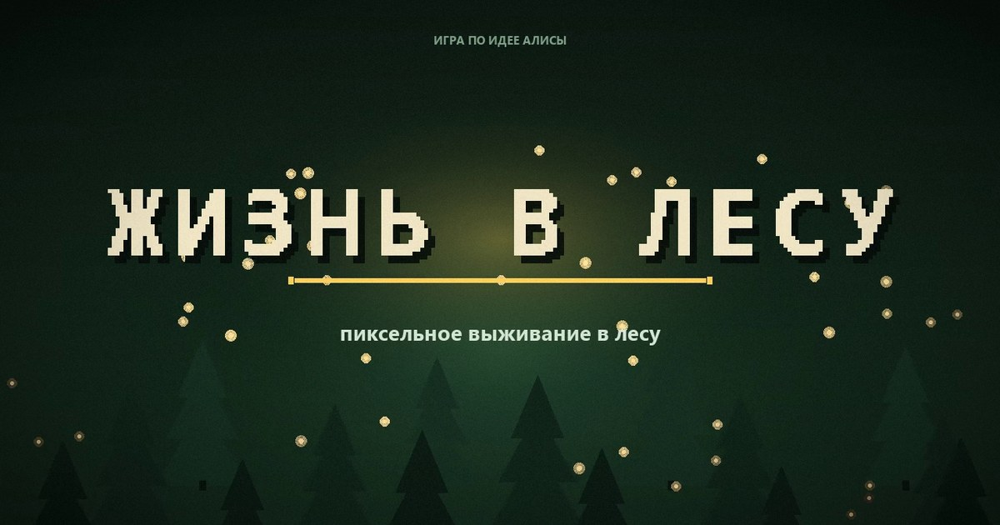

# Жизнь в лесу



Пиксельная игра о выживании в лесу. Герой оказался в чаще: нужно собрать
ресурсы, скрафтить лук и кровать, пережить ночь с волками, победить Бабу-ягу и
Лешего, выйти через ворота и добраться до города Зелёный Бор. Это финал первой
части — вторая начинается за восточной заставой.

Идея, персонажи и сценарий — **Алисы**. Код — обычный JavaScript и Canvas 2D,
без фреймворков, сборки и зависимостей: один `index.html` и один `game.js`.

| | |
|---|---|
| Жанр | выживание, пиксель-арт |
| Платформа | браузер: компьютер, телефон/планшет, геймпад |
| Технологии | HTML5 Canvas 2D + ванильный JS, ~7 200 строк |
| Сборка | не требуется — это статический сайт |
| Хостинг | GitHub Pages: **https://gagalinna.github.io/zhizn-v-lesu/** |

## Играть

- **Онлайн:** https://gagalinna.github.io/zhizn-v-lesu/
- **Локально, без установки:** дважды щёлкнуть по `index.html` (Chrome, Edge,
  Firefox, Opera) — игра работает офлайн, прямо с диска.
- **Локально через http** (ближе к тому, как будет на хостинге):

  ```bash
  node tools/serve.mjs        # http://127.0.0.1:8080/
  ```

При запуске игра показывает **краткую инструкцию**: цель, четыре первых шага
и управление под то устройство, с которого вы играете. Нажмите «Дальше» —
потом выберите героя (4 варианта) и цвет глаз (5 вариантов) и жмите
**«В ЛЕС!»**. Инструкцию можно открыть в любой момент: `H`, `Back` на
геймпаде или кнопка «?» на телефоне.

С телефона играть нужно **горизонтально** — так видны все кнопки. Если
открыть игру в портретном режиме, она сама попросит повернуть экран.
Геймпад подключается автоматически: достаточно нажать любую кнопку.

## Управление

### Компьютер

| Клавиши | Действие |
|---|---|
| `WASD` / стрелки | ходить |
| `E` или пробел | собрать, войти, поговорить, лечь спать |
| мышь | стрелять в сторону курсора |
| `F` | выстрел туда, куда смотрит герой |
| `C` | крафт (лук, стрелы, костёр, бомба, кровать) |
| `1`–`9`, `0` или клик | использовать предмет из слота инвентаря |
| `H` | краткая инструкция |
| `Esc` | закрыть окно / пауза и меню |

### Телефон и планшет

| Кнопка / жест | Действие |
|---|---|
| джойстик слева | ходить |
| **ОГОНЬ** | стрелять; герой сам целится в ближайшего врага |
| **ДЕЙСТВИЕ** | собрать, войти, поговорить, лечь спать |
| **КРАФТ** | открыть рецепты |
| слоты внизу | нажать, чтобы съесть или использовать предмет |
| **?** | пауза, инструкция, «Во весь экран», смена героя |
| касание по лесу | выстрел в точку (если есть лук) |

### Геймпад

| Кнопка | Действие |
|---|---|
| левый стик / крестовина | ходить |
| `A` | действие и «дальше» в разговоре |
| `X` / `RT` | стрелять; правый стик — прицел, без него работает автоприцел |
| `Y` | использовать выбранный предмет |
| `LB` / `RB` | выбрать слот инвентаря |
| `LT` | крафт |
| `Start` | пауза и меню |
| `Back` | краткая инструкция |
| `B` | закрыть / назад |

## Что есть в игре

- **Лес:** яблони, банановые пальмы, грядки, кусты с листьями, палки, угольные
  камни, озеро. Ресурсы отрастают заново.
- **Сутки:** примерно 3,5 минуты — день, вечер, ночь с волками, утро.
- **Пещеры (3 штуки):** темно, летают мыши, добываются уголь и кристаллы.
- **Крафт:** костёр, бомба, кровать, лук, стрелы, кристальный лук.
- **Боссы:** Баба-яга (140 HP, кидает зелья, летает, иногда с чёрной кошкой) и
  Леший (1000 HP, корни из-под земли, ранить можно только из лука).
- **Алмазики и лавка одежды:** кепка, очки, шарф, шляпа, плащ, корона.
  Экран победы над боссом — с тремя звёздами и лицом босса с крестиками вместо глаз.
- **Город Зелёный Бор:** шесть жителей с диалогами, пирожок от пекаря, лавка
  торговки. Финал первой части.
- **Сохранение:** алмазики и купленная одежда хранятся в `localStorage`
  (ключ `zhizn-v-lesu-progress-v1`).
- **Три способа играть:** клавиатура с мышью, сенсорный экран телефона и
  геймпад. Интерфейс сам подсказывает кнопки текущего устройства.
- **Инструкция и пауза:** экран «Как играть» при запуске, по `H`, `Start` или
  кнопке «?»; в паузе можно включить полный экран и сменить героя.

Подробное описание, советы и пошаговое прохождение —
[docs/как-играть.md](docs/как-играть.md).

## Структура репозитория

```
index.html                  страница игры: canvas, метатеги, иконки
game.js                     вся игра (карта, крафт, бои, диалоги, сохранения)
.nojekyll                   отключает Jekyll на GitHub Pages
vercel.json                 заголовки кэширования для Vercel (запасная площадка)
favicon.svg, favicon.ico    иконка вкладки
assets/
  og-cover.jpg              превью ссылки в мессенджерах (1200×630)
  icon-180.png              иконка «на главный экран»
docs/
  как-играть.md             правила, советы, пошаговое прохождение
  жизнь-в-лесу-дизайн-документ.md   исходная идея Алисы
  бриф-для-claude-code.md   бриф, по которому делалась игра
  обложка.png               исходник обложки
  предпросмотр/             картинки к описанию, включая телефонные экраны
tools/
  serve.mjs                 локальный сервер для проверки
  smoke-test.mjs            автотест: игра, экраны, телефон и геймпад
  render-check.mjs          снимки экранов в headless Chrome (для разработки)
  make-assets.py            пересборка иконок и og-обложки
```

## Проверка перед публикацией

```bash
node tools/smoke-test.mjs
```

Скрипт запускает `game.js` в Node с заглушками canvas/DOM и прогоняет сценарии:
инструкция при запуске, выбор персонажа, ходьба, крафт, 40 секунд геймплея,
победа над боссом, экран поражения, город с диалогом, финал, загрузка
сохранения, сенсорное управление, геймпад и широкий экран телефона. Сейчас
проходят все 80 проверок. Это ловит опечатки и падения, но не заменяет живой
прогон в браузере.

Для визуальной проверки (нужен Chrome; в одном окне — сервер, в другом — снимки):

```bash
node tools/serve.mjs 8090
node tools/render-check.mjs
```

Скрипт снимет экраны `docs/предпросмотр/как-играть.png`,
`выбор-героя.png`, `лес.png`, `пауза.png`, `помощь.png`,
`телефон-лес.png`, `телефон-инструкция.png` и `телефон-поверни.png`.

## Публикация: GitHub Pages

Сайт раздаётся прямо из этого репозитория, ветка `main`, корень. Никакой сборки
нет: GitHub Pages отдаёт файлы как есть.

- Адрес: **https://gagalinna.github.io/zhizn-v-lesu/**
- Источник: `Settings → Pages → Build and deployment → Deploy from a branch →
  main / (root)`
- Файл `.nojekyll` в корне отключает обработку Jekyll, чтобы файлы публиковались
  без изменений.
- Каждый `git push` в `main` пересобирает сайт за минуту-две.

> Почему не Vercel. Проект на Vercel собран и лежит по адресу
> `https://zhizn-v-lesu.vercel.app`, но с некоторых российских провайдеров
> IP-адреса Vercel (`64.29.17.x`, `216.198.79.x`) недоступны — соединение
> сбрасывается. GitHub Pages открывается нормально, поэтому основная площадка —
> он. Конфиг `vercel.json` оставлен: если понадобится вернуться на Vercel или
> открывать его через VPN, всё уже готово.

## Как обновить игру

```bash
git add -A
git commit -m "что изменилось"
git push
```

Если правили картинки-иконки — `python tools/make-assets.py` (нужен Pillow).
Видео-ролик `жизнь-в-лесу-ролик.mp4` в репозиторий не входит: он весит 8 МБ и
для сайта не нужен (см. `.gitignore`).

## Сбросить прогресс

В браузере: `F12` → Console → `localStorage.removeItem('zhizn-v-lesu-progress-v1')`
→ `F5`. Алмазики и одежда обнулятся, сама игра не пострадает.

## Авторство

Идея, персонажи, дизайн-документ и тексты — Алиса. Реализация — в паре с
ИИ-помощником. Игра сделана для домашнего запуска и как первая часть истории:
продолжение задумано, но ещё не написано.
