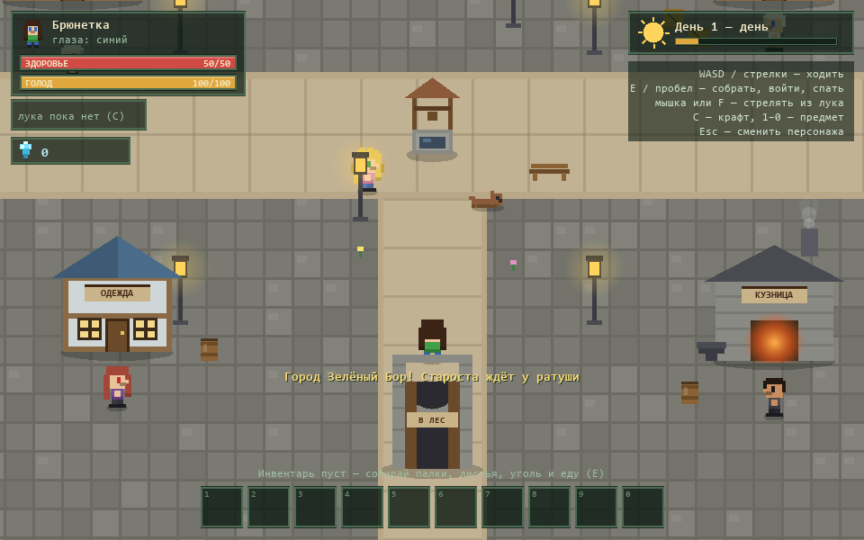
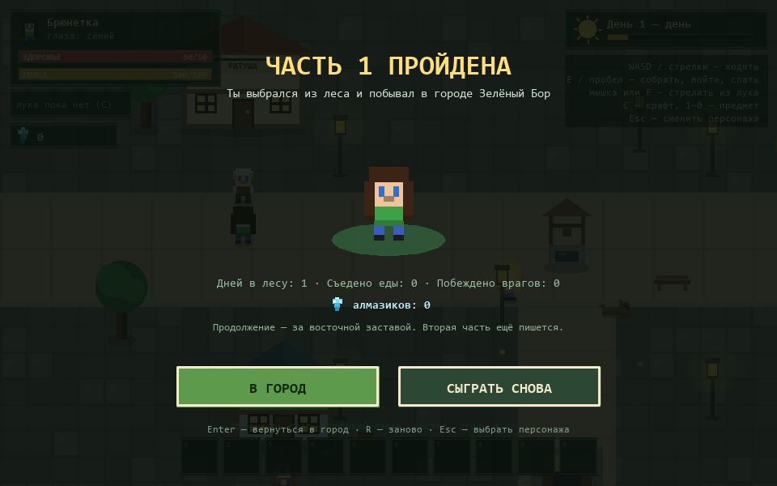

# «Жизнь в лесу» — описание и как играть

## Что это за игра

Пиксельная 2D-игра про выживание в лесу, придуманная Алисой. Ты играешь за
ребёнка, который оказался в опасном лесу и хочет выбраться: собрать ресурсы,
смастерить лук и кровать, пережить ночь, победить Бабу-ягу и Лешего, выйти
через ворота в город и поговорить со старостой.

Это **первая часть** истории. За восточной заставой начинается вторая — она
пока не сделана, но место для неё уже есть.

Технически это один файл `index.html` и `game.js`. Ничего устанавливать не
нужно, интернет не нужен: игра работает офлайн в любом браузере.

Онлайн-версия: **https://gagalinna.github.io/zhizn-v-lesu/**

## Как запустить

1. Открыть папку с игрой.
2. Дважды щёлкнуть по `index.html` (или перетащить файл в окно браузера).
3. Если открылось не в браузере — правый клик → «Открыть с помощью» → Chrome,
   Edge или Opera.

`F5` — перезагрузить игру. Прогресс (алмазики и одежда) при этом сохраняется.

## Цель

1. Выжить в лесу и добыть лук.
2. Победить **Бабу-ягу** у её избушки.
3. Победить **Лешего** у ворот из леса.
4. Выйти в город **Зелёный Бор**, поговорить с жителями.
5. Дослушать старосту — это финал первой части.

## Кто такой герой

В начале ты выбираешь одного из четырёх персонажей (брюнетка, блондинка,
мальчик тёмненький, мальчик блондин) и цвет глаз (синий, зелёный, красный,
оранжевый, чёрный). Кроссовки всегда чёрные.

- **Здоровье (HP): 50**
- **Голод: 100** — тратится примерно за 5 минут игры.

Когда голод на нуле, здоровье потихоньку убывает (1 HP каждые 3 секунды).
Когда голод выше 70, здоровье само восстанавливается, а рядом с костром —
вдвое быстрее.

## Мир

- **Лес** — главная карта, старт в центре. Поляна, деревья, озеро, яблони,
  банановые пальмы, грядки, кусты с листьями, сухие палки, угольные камни.
- **Пещеры** — три входа в лесу. Внутри темно, летают мыши (чем глубже, тем
  сильнее), добываются уголь и кристаллы.
- **Избушка Бабы-яги** — на западе, на курьих ножках, с огородом.
- **Ворота из леса** — на северо-востоке, охраняет Леший.
- **Город Зелёный Бор** — открывается после победы над Лешим.

## Сутки и сон

Сутки идут примерно 3,5 минуты: день (2 минуты), вечер, ночь (1 минута),
утро. Ночью темнеет, а у леса появляются волки. Волки дают мясо, мясо жарят
на костре (+30 сытости).

Кровать крафтится из 3 палок и 4 листьев. Поставить её можно из инвентаря,
а лечь — только ночью и если рядом нет волков. Сон: +15 HP, −12 голода,
наступает новый день.

## Еда

| Еда | Сытость |
|---|---|
| Яблоко | +12 |
| Банан | +15 |
| Овощ | +8 |
| Морковь (с огорода Яги) | +10 |
| Пирожок (даёт пекарь в городе) | +35 |
| Жареное мясо | +30 |
| Сырое мясо | +4 |

Съесть предмет — выбрать его слот в инвентаре (клавиши 1–0 или клик).

## Крафт (клавиша C)

| Что получится | Из чего |
|---|---|
| Костёр | 2 палки + 1 уголь |
| Бомба | 1 спичка + 1 яблоко |
| Кровать | 3 палки + 4 листа |
| Лук | 2 палки + 2 листа |
| Стрелы ×3 | 1 палка + 1 лист |
| Кристальный лук | 1 лук + 3 кристалла |

Костёр и кровать ставятся из инвентаря: выбираешь слот — предмет появляется
перед персонажем.

Ресурсы: палки лежат на земле, листья — на кустах, уголь — в камнях и пещерах,
спички — в коробках, кристаллы — в пещерах. Всё со временем отрастает снова.

## Бой

- **Лук** — основное оружие. Стрелять: мышкой в сторону курсора, клавишей
  `F` в сторону взгляда или пробелом.
- **Бомбы** — бросаются из слота инвентаря, взрываются по площади, но ранят
  и самого героя, если близко.
- **Волки** приходят ночью, **летучие мыши** живут в пещерах.
- У обычных врагов стрела снимает 5 HP, у боссов — 20 (кристальный лук — 40).

### Баба-яга (140 HP)

Стоит в избушке. Подходишь, `E` — начинается бой. Она летает, держит
дистанцию и кидает зелья: попадание снимает 10 HP. Когда у неё меньше
половины здоровья, злится: кидает чаще и телепортируется в дыму.
Иногда появляется с чёрной кошкой — та болтает то полезное, то ерунду.

После победы: открывается **огород с морковью**, в избушке остаются зелья —
синее лечит +25 HP, зелёное травит (−1 HP в секунду).

### Леший (1000 HP)

Стоит у ворот. Ранить можно **только из лука** — бомбы не берут. Бьёт лапой,
а главное — выпускает корни: сначала на земле загорается круг, через секунду
оттуда лезут шипы. На половине здоровья впадает в ярость.

После победы ворота открываются и ведут в город.

## Алмазики, звёзды и одежда

За победу над боссом дают алмазики: за Бабу-ягу 3, за Лешего 6, плюс 1 за
бой на три звезды (звёзды дают за здоровье в конце боя: 30+ из 50 — три,
15+ — две, иначе одна).

На экране победы — картинка, три звезды и лицо побеждённого босса
с крестиками вместо глаз.

Алмазики тратятся в **лавке одежды** (телега рядом со стартом в лесу, а ещё
лавка у торговки в городе):

| Одежда | Цена |
|---|---|
| Красная кепка | 2 ♦ |
| Круглые очки | 2 ♦ |
| Тёплый шарф | 3 ♦ |
| Соломенная шляпа | 4 ♦ |
| Лесной плащ | 6 ♦ |
| Корона | 8 ♦ |

Купленная вещь сразу надевается, повторный клик — снимает. Шапки
взаимоисключающие: наденешь корону — кепка снимется. Одежда видна на
персонаже везде: на выборе героя, в игре, на экранах победы и финала.

## Город

Попасть туда можно через ворота из леса после победы над Лешим. В городе
безопасно: волков и мышей нет.

| Житель | Чем полезен |
|---|---|
| Староста Игнат | рассказывает про город и дорогу на восток, после разговора — финал |
| Мила | болтает про Лешего, Бабу-ягу и своего пса |
| Пекарь Тихон | угощает пирожком (один раз за игру) |
| Кузнец Руд | хвалит лук и намекает на оружие для второй части |
| Торговка Агафья | открывает лавку одежды |
| Пёс Бублик | спит и говорит «Гав!» |

Городские ворота с надписью «В ЛЕС» возвращают в лес. Указатель
«НА ВОСТОК» — это дорога во вторую часть, её ещё не сделали.

Когда дослушаешь старосту до конца, появится экран **«ЧАСТЬ 1 ПРОЙДЕНА»**:
можно вернуться в город и гулять дальше или начать заново.

## Управление

| Клавиши | Действие |
|---|---|
| WASD / стрелки | ходить |
| E или пробел | собрать, войти, лечь спать, поговорить, прочитать |
| E / пробел / Enter в разговоре | следующая фраза |
| Мышка | стрелять туда, где курсор (если есть лук) |
| F | выстрел в сторону взгляда |
| C | крафт (во время боя с боссом недоступен) |
| 1–9, 0 | использовать предмет из слота |
| Клик по слоту | то же самое |
| Esc | закрыть крафт/лавку/разговор, выйти к выбору персонажа |
| Enter / Esc на экране поражения | начать заново / выбрать другого героя |
| Enter / Esc на экране победы над боссом | продолжить |
| Enter на финале / R / Esc | вернуться в город / начать заново / выбрать героя |

На экране выбора персонажа: `←` `→` — герой, `↑` `↓` или `1–5` — цвет глаз,
`Enter` — начать.

## Как играть: пошагово

1. **Выбери героя** и нажми «В ЛЕС!». Ты появишься в центре леса.
2. **Собери 2 палки и 2 листа** (палки лежат на земле, листья — на кустах),
   нажми `C` и скрафти лук. Ещё палку с листом — на стрелы (получится 3).
3. **Следи за голодом.** Ешь яблоки, бананы и овощи: подойди и нажми `E`,
   потом выбери еду в инвентаре.
4. **Иди к избушке** — она на западе (влево и вверх от старта). Подойди
   и нажми `E`: выйдет Баба-яга.
5. **Стреляй мышкой** и уходи в сторону, когда она кидает зелье. На половине
   здоровья она начнёт телепортироваться.
6. **После победы** нарви моркови на огороде и забери зелья в избушке.
7. **К вечеру скрафти кровать** и поспи, если рядом нет волков.
8. **Иди к воротам** — на северо-восток. Там Леший. Ему нужно много стрел:
   проще сначала сделать кристальный лук (3 кристалла в пещерах).
9. **Победи Лешего** и войди в город. Поговори со всеми, купи одежду
   у торговки, возьми пирожок у пекаря.
10. **Дослушай старосту** — это финал первой части.

## Советы

- Не подпускай волков близко: стреляй издалека и отходи.
- Ночью у костра здоровье восстанавливается быстрее, а волки не так страшны.
- Бомба хороша против стаи, но отбеги сам.
- В пещерах темно: помогает костёр и своё «свечение» вокруг героя.
- Синее зелье — лечит, зелёное — яд. Не пей зелёное просто так.
- В инвентаре 10 слотов: не набирай лишнего, ешь и используй.
- Стрелы кончаются: всегда носи с собой палки и листья.
- Убежать с поля боя можно — но босс залечит раны и вернётся на место.

## Сохранение прогресса

Алмазики и купленная одежда сохраняются в браузере и остаются после
перезапуска и закрытия игры.

Сбросить прогресс: `F12` → вкладка **Console** → вставить
`localStorage.removeItem('zhizn-v-lesu-progress-v1')` → `Enter` → `F5`.

## Если что-то не работает

- Пустой экран или странности — `F12` → **Console**, там будет красная ошибка
  с номером строки в `game.js`.
- Игра «зависла» — `F5` или кнопка «Начать заново».
- Файл `game.js` должен лежать рядом с `index.html`.
